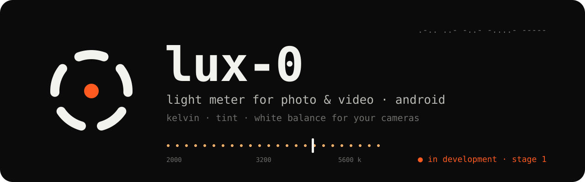

<p align="center">
  
</p>

<p align="center"><a href="README.md">Español</a> · <b>English</b></p>

# LUX-0

**A light meter for photo and video, for Android.** LUX-0 uses the phone's camera and light sensor to measure **color temperature (Kelvin), tint, exposure, lux, and flicker**. It then tells you what to set on **your cameras**: white balance, aperture, and a safe shutter.

> **Public beta v0.3.2: looking for beta testers.** 🧪
> Every tool works and has been tested on a Samsung Galaxy S26 Ultra. We need testing on **more phones and more lights** to validate accuracy.
> The app is in **English and Spanish** and follows the phone's language.

---

## Install the beta

1. Go to **[Releases](https://github.com/Ultramal13/lux-0/releases)** and download the latest APK (`LUX-0-v0.3.2-beta.apk`).
2. Open it on your Android phone. If asked, allow **"install unknown apps"** for your browser or file manager.
3. Open LUX-0 and grant the **camera** permission, which is the only one it asks for. If the request doesn't appear, turn it on in **Settings → Apps → LUX-0 → Permissions → Camera**.

**Requirements:**
- Android 12 or later.
- A camera that allows **manual color control**. Most mid- and high-end phones do. If yours does not, the app tells you on screen.

**Tested on:** Samsung Galaxy S26 Ultra (Android 17), Sony Xperia 1 III (Android 13) and LG V60 ThinQ (Android 12, the minimum version). Tell us how it works on yours!

---

## How to help as a beta tester

- **Use it on real shoots** under different lights: daylight, overcast, warm bulbs, LEDs, fluorescents, and mixed light.
- **Compare it with your camera.** Check the white balance from your camera or your raw editor (Capture One, Lightroom, DPP) against LUX-0. A light meter or color meter is even better.
- **Report what you find** in **[Issues](https://github.com/Ultramal13/lux-0/issues/new/choose)**. There are two forms: *"problem"* and *"measurement / suggestion"*. Always include:
  - your **phone model** and Android version
  - what you were measuring, and under which light
  - a **screenshot**, if you can
  - for measurements: the LUX-0 value and your reference value

---

## Tools

| Key | Tool | What it does |
|---|---|---|
| **1 · K** | **Color** | Live Kelvin and tint. Aim the circle at a white sheet or gray card, or use a diffuser. You get the exact value for **Camera 1 and Camera 2**, already rounded to each camera's steps (for example, Canon's G/M WB Shift). |
| **2 · EV** | **Exposure** | The scene EV, plus an **assistant** that suggests the full **shutter · aperture · ISO** combination for each camera. It accounts for the lens (with the sensor format), stabilization, subject (still, person, sport…), handheld or tripod, photo or video, and your intent (high or low key, protect highlights, open shadows). |
| **3 · lx** | **Lux** | Lux and foot-candles from the phone's front light sensor. |
| **4 · Hz** | **Flicker** | Detects pulsing lights (100/120 Hz) and tells you which **shutter is safe** for each camera's fps, as a speed and as an angle. |
| **5 · A\|B** | **Compare** | Measures two lights and suggests the **gel** to match them (CTO/CTB and ≈ green/magenta), or the K value for a panel. |
| **6 · ▦** | **Map** | A grid over the viewfinder shows which areas get warmer (orange) or cooler (blue) light. |

**Also included:**
- **Sessions per shoot.** Each reading is saved with time, thumbnail, comment, and camera settings. Sessions export to **CSV** for the colorist.
- **50 cameras** from Canon, Sony, Nikon, Fujifilm, Panasonic, Blackmagic, GoPro, and Insta360, with data taken from official manuals (models marked **\*** have some value the manufacturer does not publish), plus **custom cameras**. Each brand corrects tint differently (G/M, R/B, or Tint), and the app gives it to you in those units. Capture settings (ISO, fps, shutter, f-stop, ND, and EV) are picked from lists.
- **Target temperature,** with the gel needed to reach it.
- **Calibration** against your own camera (a raw photo of a white sheet), plus fine adjustments for exposure and lux.
- **Themes:** light, dark, and **red night** for dark sets.
- **Built-in help** (the **?** button) that explains every setting.
- **Phone care:**
  - a small analysis image at a low frame rate
  - thermal protection
  - automatic pause after 90 s without use
  - "hold" turns the camera off

---

## Privacy

- **No internet.** The app does not even request that permission. No accounts, ads, or analytics.
- **Your data stays on your phone.** Sessions, thumbnails, and settings are excluded from cloud backup and device transfer.
- **The CSV leaves the phone only when you share it,** with the "export csv" button.

## Disclaimer

LUX-0 is **beta** software provided **"as is"**, without warranty:

- **Measurements are for guidance only.** Check them with your camera before important work.
- **It is not guaranteed to work on every phone.** On launch, the app checks yours and runs in **full**, **lite** (on basic devices it measures more slowly and turns off flicker and map), or **no compatible camera** mode (lux only). The first time, it asks you to accept this disclaimer.
- **You use it at your own risk.** Bexia is not liable for phone malfunction or heating, data loss, or affected work.
- **Camera brands mentioned** belong to their owners and are not affiliated with the project.

Full text in [`LICENSE`](LICENSE).

## Known limitations

**Estimated accuracy,** which this beta is meant to validate. Real comparisons are logged in [`docs/validacion.md`](docs/validacion.md). The first one, on an S26 Ultra against the R5 with Capture One, showed an 18-mired offset before calibration, which calibration corrects.

| Measurement | Accuracy |
|---|---|
| Color with a sheet or diffuser, calibrated | ±150–300 K |
| Color in scene mode | ±500 K or more |
| Exposure | ±⅓–½ stop |

**Other limitations:**
- **Canon tint** is approximate, because Canon does not publish the exact equivalence.
- **Map and scene mode** depend on surface colors, so treat them as a guide.
- **Lux** depends on each phone's sensor. Use it to compare lights.
- **Flicker** needs a phone that allows manual exposure and reports its readout time. If it does not, the app tells you.
- **DJI** is not listed, because its manuals do not publish the Kelvin range. **Sony** does not publish its Kelvin step, so its models carry a \*. If your camera is missing or a value looks wrong, use "+ custom camera" and send us its data (K range, step, and max ISO) so we can add it.
- **Tint** in each camera's units is approximate (≈), because no manufacturer publishes the exact equivalence.

---

## Screenshots

| Color | Exposure | Flicker |
|---|---|---|
|  |  |  |

| Compare | Map | Lux (real phone, Spanish UI) |
|---|---|---|
|  |  |  |

<sub>Emulator screenshots show simulated readings (demo mode).</sub>

---

## How it measures

1. It takes a small (640×480) image in the camera's lightweight viewfinder mode and **turns off the phone's color processing**: auto white balance off, a neutral color matrix, and a linear tone curve.
2. It averages the color inside the circle and converts it to **CIE 1931 xy** using the sensor's own factory calibration matrices (the same method as the DNG format).
3. It computes the **CCT** (Planckian locus, Krystek approximation) and the **Duv**, then translates the result for each camera.
4. For exposure, it uses the settings the phone picks for the circle (EV100). For flicker, it reads the rolling-shutter bands at 1/2000 s.

Everything relies on public colorimetry standards. More detail in [`HOW-IT-WORKS.txt`](HOW-IT-WORKS.txt).

## Technology

- Native Android · **Kotlin** · **Jetpack Compose** · **Camera2**
- No third-party libraries or external services.
- 36 unit tests covering colorimetry, exposure, gels, flicker, the map, image reading, CSV export, and the capture lists.

## Build

```bash
export JAVA_HOME=/path/to/jdk-21
./gradlew :app:testDebugUnitTest   # tests
./gradlew :app:assembleDebug       # development APK in app/build/outputs/apk/debug/
```

Create a `local.properties` file with `sdk.dir=/path/to/android-sdk`.

On the emulator, the app switches to **demo mode**. The readings are simulated and labeled as such.

## Documentation (in Spanish)

- [`docs/2026-10-19-lux0-diseno.md`](docs/2026-10-19-lux0-diseno.md): design and decisions.
- [`docs/superpowers/plans/`](docs/superpowers/plans/): stage 1 and stage 2 plans.
- [`docs/validacion.md`](docs/validacion.md): real measurements compared with cameras and references.
- [`AGENTS.md`](AGENTS.md): guide for picking the project up with an AI coding assistant.

---

<sub>Original "handheld device" design. The icon is the digit **0** in Morse code (−−−−−) drawn as a ring, with a point of light in the center.</sub>

<sub>© 2026 **Bexia**. All rights reserved. You may download and use the beta and report issues; the code may not be copied or redistributed without permission. See [`LICENSE`](LICENSE).</sub>
