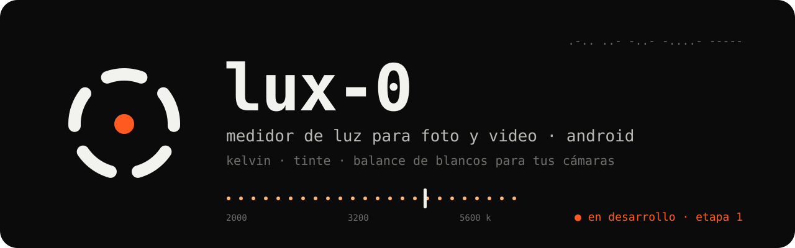
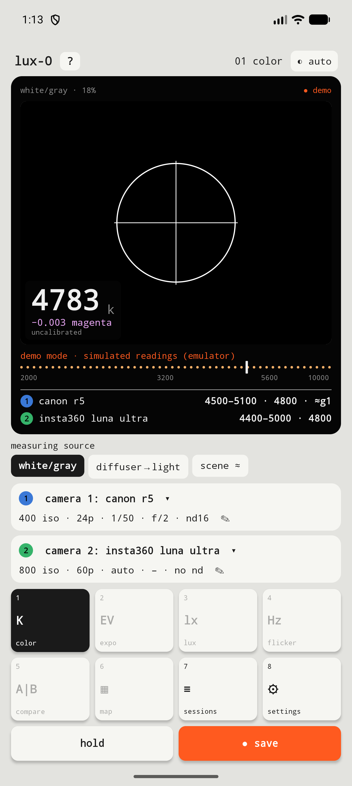
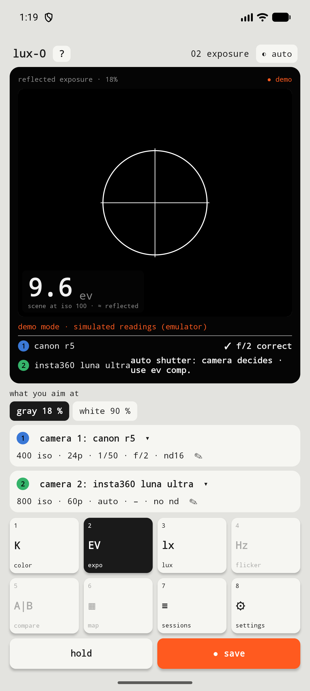
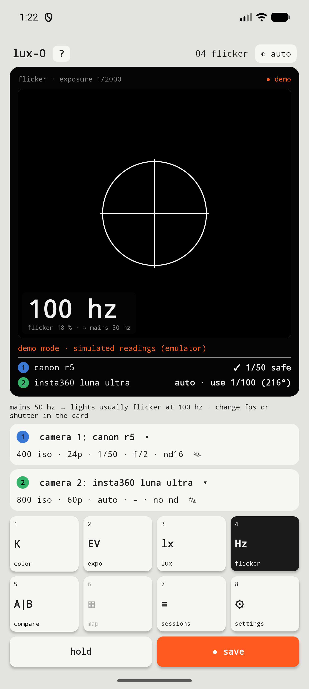
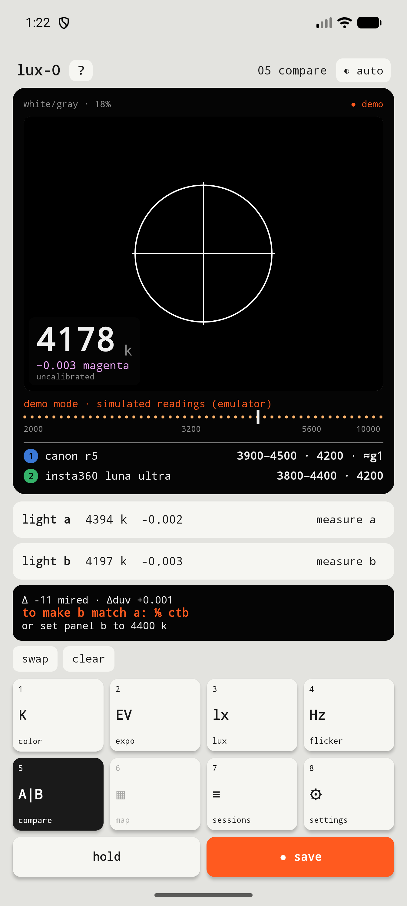
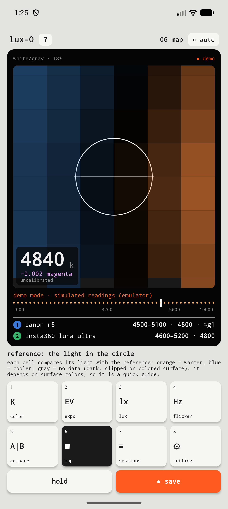
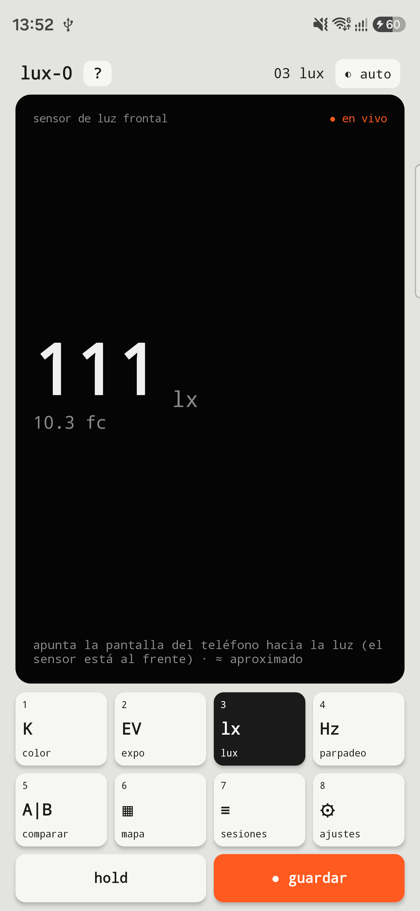

<p align="center">
  
</p>

<p align="center"><b>Español</b> · <a href="README.en.md">English</a></p>

# LUX-0

**Medidor de luz para foto y video, para Android.** Usa la cámara y el sensor de luz del celular para medir **temperatura de color (Kelvin), tinte, exposición, lux y parpadeo**. Te dice qué poner en **tus cámaras**: balance de blancos, diafragma y obturación segura.

> **Beta pública v0.2.0 — buscamos betatesters.** 🧪
> Todas las herramientas funcionan y están probadas en un Samsung Galaxy S26 Ultra. Necesitamos probarla en **más teléfonos y más luces** para validar la precisión.
> La app está en **español e inglés** y usa el idioma del teléfono.

---

## Instalar la beta

1. Entra a **[Releases](https://github.com/Ultramal13/lux-0/releases)** y descarga `LUX-0-v0.2.0-beta.apk`.
2. Ábrelo en tu Android. Si el teléfono lo pide, permite **"instalar apps desconocidas"** para tu navegador o administrador de archivos.
3. Abre LUX-0 y acepta el permiso de **cámara**, que es el único que pide.

**Requisitos:**
- Android 12 o superior.
- Una cámara que permita **controlar el color manualmente**. La mayoría de los teléfonos de gama media y alta lo permiten; si el tuyo no, la app lo avisa en pantalla.

**Probado en:** Samsung Galaxy S26 Ultra (Android 17). ¡Cuéntanos cómo funciona en el tuyo!

---

## Cómo ayudar como betatester

- **Úsala en rodajes o sesiones reales,** con distintas luces: día, nublado, ampolletas cálidas, LED, fluorescentes y luces mezcladas.
- **Compárala con tu cámara:** el balance que te da tu cámara o tu programa de revelado (Capture One, Lightroom, DPP) frente al que da LUX-0. Si tienes un fotómetro o colorímetro, mejor aún.
- **Reporta lo que encuentres** en **[Issues](https://github.com/Ultramal13/lux-0/issues/new/choose)**. Hay dos formularios: *"problema"* y *"medición / sugerencia"*. Incluye siempre:
  - el **modelo de tu teléfono** y la versión de Android
  - qué estabas midiendo y con qué luz
  - una **captura de pantalla**, si puedes
  - en mediciones: el valor de LUX-0 y el de tu referencia

---

## Herramientas

| Tecla | Herramienta | Qué hace |
|---|---|---|
| **1 · K** | **Color** | Kelvin y tinte en vivo. Apuntas el círculo a una hoja blanca o tarjeta gris, o usas un difusor. Te da el valor exacto para **Cámara 1 y Cámara 2**, ya redondeado a los pasos de cada una (por ejemplo, el WB Shift G/M de Canon). |
| **2 · EV** | **Exposición** | El EV de la escena y el **diafragma sugerido** para cada cámara según su ISO, obturación, ND y EV. Si ya fijaste un f/, te dice cuántos pasos sobran o faltan. |
| **3 · lx** | **Lux** | Lux y pie-candela con el sensor de luz del frente del teléfono. |
| **4 · Hz** | **Parpadeo** | Detecta luces que pulsan (100/120 Hz) y te dice qué **obturación es segura** para los fps de cada cámara, como velocidad y como ángulo. |
| **5 · A\|B** | **Comparar** | Mide dos luces y sugiere el **gel** para igualarlas (CTO/CTB y ≈ verde/magenta) o el valor en K para un panel. |
| **6 · ▦** | **Mapa** | Una grilla sobre el visor muestra qué zonas reciben luz más cálida (naranja) o más fría (azul). |

**Además:**
- **Sesiones por rodaje:** cada medición se guarda con hora, miniatura, comentario y ajustes de cámara. Se exportan a **CSV** para el colorista.
- **50 cámaras** de Canon, Sony, Nikon, Fujifilm, Panasonic, Blackmagic, GoPro e Insta360, con datos tomados de los manuales oficiales (las que llevan **\*** tienen algún dato que el fabricante no publica), más **cámaras personalizadas**. Cada marca corrige el tinte a su manera (G/M, R/B o Tint) y la app te lo da en esas unidades. Los ajustes de captura (ISO, fps, obturación, f/, ND y EV) se eligen de listas.
- **Temperatura objetivo** con el gel para llegar a ella.
- **Calibración** contra tu propia cámara (foto RAW de una hoja blanca), más ajustes finos de exposición y lux.
- **Temas** claro, oscuro y **noche rojo** para sets a oscuras.
- **Ayuda integrada** (botón **?**) que explica cada parámetro.
- **Cuidado del teléfono:**
  - imagen de análisis pequeña y pocos cuadros por segundo
  - protección térmica
  - pausa automática tras 90 s sin uso
  - "hold" apaga la cámara

---

## Privacidad

- **No usa internet.** Ni siquiera pide ese permiso. Sin cuentas, publicidad ni análisis de uso.
- **Tus datos se quedan en tu teléfono.** Sesiones, miniaturas y ajustes no se suben al respaldo en la nube ni viajan al cambiar de teléfono.
- **El CSV sale solo cuando tú lo compartes,** con el botón "exportar csv".

## Limitaciones conocidas

**Precisión estimada,** en validación justamente con esta beta. Las comparaciones reales se registran en [`docs/validacion.md`](docs/validacion.md); la primera, en un S26 Ultra contra la R5 con Capture One, mostró una desviación de 18 mired sin calibrar, que se corrige con la calibración.

| Medición | Precisión |
|---|---|
| Color con hoja o difusor, calibrado | ±150–300 K |
| Color en modo escena | ±500 K o más |
| Exposición | ±⅓–½ paso |

**Otras limitaciones:**
- El **tinte para Canon** es aproximado: Canon no publica la equivalencia exacta.
- **Mapa y modo escena** dependen del color de las superficies: son una guía.
- **Lux** depende del sensor de cada teléfono: úsalo para comparar.
- **Parpadeo** necesita que el teléfono permita exposición manual e informe su tiempo de lectura. Si no, la app lo avisa.
- **DJI** no aparece porque sus manuales no publican el rango de Kelvin. **Sony** no publica de cuánto en cuánto sube el Kelvin, así que sus modelos llevan \*. Si tu cámara no está o ves un dato malo, usa "+ cámara personalizada" y cuéntanos sus datos (rango de K, paso e ISO máximo) para agregarla.
- El **tinte** en unidades de cada cámara es aproximado (≈): ningún fabricante publica la equivalencia exacta.

---

## Capturas

| Color | Exposición | Parpadeo |
|---|---|---|
|  |  |  |

| Comparar | Mapa | Lux (teléfono real) |
|---|---|---|
|  |  |  |

<sub>Las capturas del emulador muestran lecturas simuladas (modo demo) y salen en inglés porque el emulador está en ese idioma.</sub>

---

## Cómo mide

1. Toma una imagen pequeña (640×480) en el modo liviano del visor de la cámara y **apaga el procesamiento de color del teléfono**: balance automático apagado, matriz de color neutra y curva lineal.
2. Promedia el color del círculo y lo convierte a **CIE 1931 xy** con las matrices de calibración de fábrica del propio sensor, con el mismo método que el formato DNG.
3. Calcula la **CCT** (locus de Planck, aproximación de Krystek) y el **Duv**, y traduce el resultado a cada cámara.
4. Para exposición usa los ajustes que elige el teléfono para el círculo (EV100). Para parpadeo, las bandas del rolling shutter a 1/2000 s.

Todo se basa en estándares públicos de colorimetría. Más detalle en [`COMO-FUNCIONA.txt`](COMO-FUNCIONA.txt).

## Tecnología

- Android nativo · **Kotlin** · **Jetpack Compose** · **Camera2**
- Sin librerías de terceros ni servicios externos.
- 36 pruebas unitarias: colorimetría, exposición, geles, parpadeo, mapa, lectura de imagen, CSV y listas de captura.

## Compilar

```bash
export JAVA_HOME=/ruta/a/jdk-21
./gradlew :app:testDebugUnitTest   # pruebas
./gradlew :app:assembleDebug       # APK de desarrollo en app/build/outputs/apk/debug/
```

Crea un `local.properties` con `sdk.dir=/ruta/al/android-sdk`. En el emulador la app entra en **modo demo**, con lecturas simuladas y marcadas.

## Documentación

- [`docs/2026-10-19-lux0-diseno.md`](docs/2026-10-19-lux0-diseno.md): diseño y decisiones.
- [`docs/superpowers/plans/`](docs/superpowers/plans/): planes de las etapas 1 y 2.
- [`docs/validacion.md`](docs/validacion.md): mediciones reales comparadas con cámara y referencias.
- [`AGENTS.md`](AGENTS.md): guía para retomar el proyecto con un asistente de IA.

---

<sub>Diseño propio estilo "aparato de mano". El ícono es el **0** en código Morse (−−−−−) en forma de anillo, con un punto de luz.</sub>

<sub>© 2026 **Bexia**. Todos los derechos reservados. Puedes descargar y usar la beta y reportar problemas; el código no se puede copiar ni redistribuir sin permiso. Ver [`LICENSE`](LICENSE).</sub>
