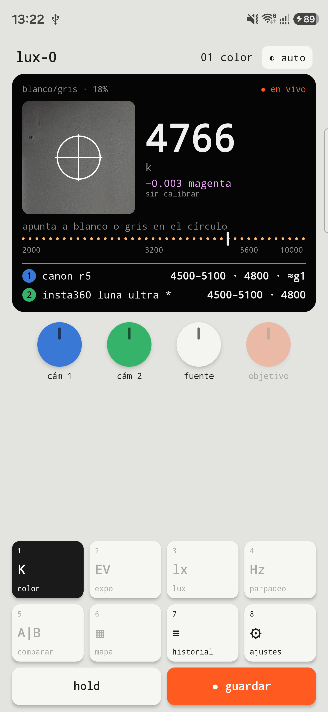
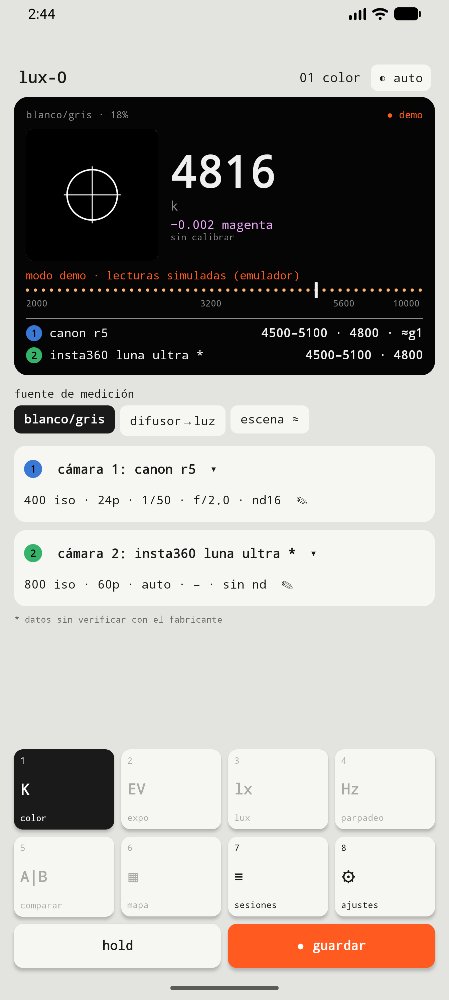
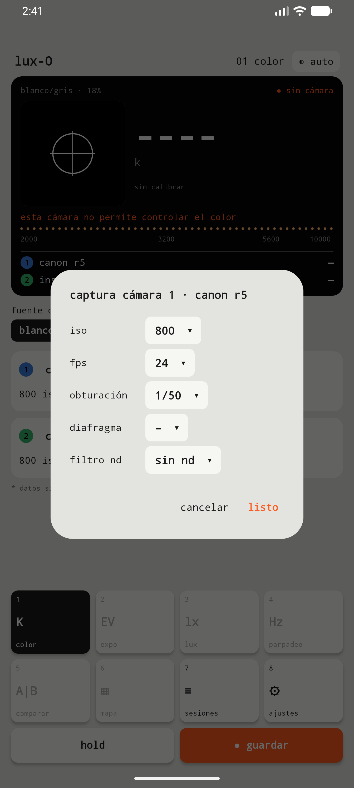
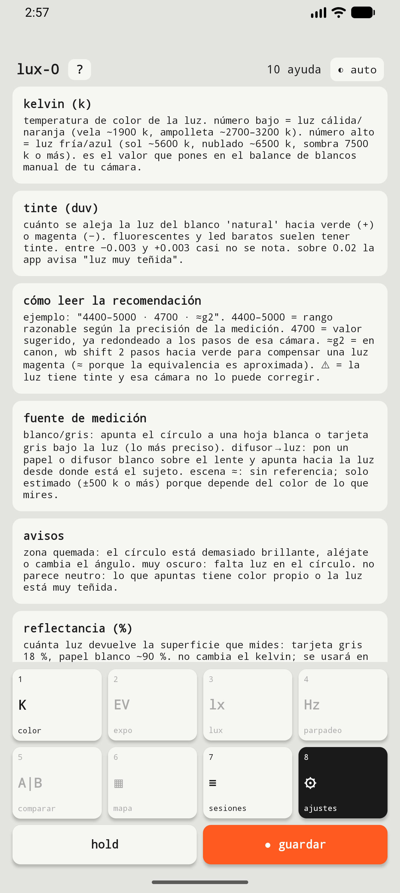

<p align="center">
  
</p>

<p align="center"><b>Español</b> · <a href="README.en.md">English</a></p>

# LUX-0

**Medidor de luz para foto y video, para Android.** Usa la cámara del celular como sensor: mide la **temperatura de color (Kelvin)** y el **tinte verde/magenta** de la luz, y te dice qué poner en el balance de blancos manual de **tus cámaras** (por ejemplo una Canon R5 o una Insta360 Luna Ultra).

No toma fotos. Es un instrumento de medición.

> **Estado: en desarrollo — etapas 1 y 2 implementadas, en pruebas.**
> Mide y recomienda valores, pero falta validar la precisión en terreno y el consumo de batería y temperatura en uso prolongado. Todavía no hay versión publicada.
>
> La app está en **español e inglés**: usa el idioma del teléfono.

---

## Capturas

| Medición (teléfono real) | Medición (emulador, modo demo) | Ajustes de captura | Ayuda |
|---|---|---|---|
|  |  |  |  |

---

## Qué hace (etapa 1)

- **Kelvin y tinte en vivo:** se apunta el círculo a una hoja blanca o una tarjeta gris, o se mide la luz a través de un difusor.
- **Recomendación por cámara (Cámara 1 y Cámara 2).** Por ejemplo, `4400–5000 · 4700 · ≈g2`:
  - rango razonable
  - valor redondeado a los pasos de esa cámara
  - corrección de tinte en sus unidades (WB Shift G/M de Canon)
- **Base de cámaras:**
  - Canon R5 e Insta360 Luna Ultra, con datos verificados.
  - Cámaras personalizadas: rango de K, paso, tinte e ISO máximo.
- **Ajustes de captura por cámara,** elegidos de listas: ISO, fps, obturación, f/, ND y compensación EV.
- **Sesiones por rodaje:** cada medición guarda hora, miniatura, comentario y ajustes. Se exporta a **CSV** para el colorista.
- **Calibración** contra una referencia: una foto RAW de una hoja blanca con tu cámara.
- **Temas:** claro, oscuro y **noche rojo**, este último para sets a oscuras.
- **Cuidado del teléfono:**
  - protección térmica
  - pausa automática tras 90 s sin uso
  - imagen de análisis pequeña y pocos cuadros por segundo
- **Ayuda integrada,** que explica cada parámetro.

## Etapa 2 (implementada, en pruebas)

- **Exposición:** EV de la escena y diafragma sugerido, o pasos de diferencia, para cada cámara según su ISO, obturación, ND y EV.
- **Lux:** con el sensor de luz frontal del teléfono.
- **Parpadeo:** detecta 100/120 Hz con las bandas del rolling shutter (1/2000 s) y dice qué obturación es segura para los fps de cada cámara.
- **Comparar dos luces:** diferencia en mired y tinte, más el gel sugerido (CTO/CTB y ≈ Plus/Minus Green) o el valor para un panel.
- **Mapa de luces mezcladas:** grilla sobre el visor, en naranja las zonas más cálidas y en azul las más frías.
- **Temperatura objetivo:** con el gel para llegar a ella.

---

## Cómo mide

1. Toma una imagen pequeña (640×480) del visor de la cámara, a pocos cuadros por segundo.
2. **Apaga el procesamiento de color del teléfono:**
   - balance de blancos automático apagado
   - matriz de color identidad
   - curva de tono lineal

   Así los valores son los del sensor.
3. Promedia el color del círculo central y avisa si está quemado, muy oscuro o no parece neutro.
4. Convierte el RGB del sensor a **CIE 1931 xy** con las matrices de calibración de fábrica del propio sensor, con el mismo método que el formato DNG.
5. Calcula la **CCT** (punto más cercano del locus de Planck, aproximación de Krystek 1985 en CIE 1960 uv) y el **Duv**.
6. Traduce el resultado a cada cámara según su rango, sus pasos y su sistema de tinte.

Todo se basa en estándares públicos de colorimetría. Más detalle en [`COMO-FUNCIONA.txt`](COMO-FUNCIONA.txt).

**Precisión esperada** (estimada, en validación):

| Modo | Precisión |
|---|---|
| Hoja o difusor, calibrado | ±150–300 K |
| Modo escena | ±500 K o más |

## Tecnología

- Android nativo · **Kotlin** · **Jetpack Compose** · **Camera2**
- Gradle 9 + Android Gradle Plugin 9 · JDK 21 · compileSdk 37 · minSdk 31 (Android 12)
- Sin librerías de terceros ni servicios externos. Los datos se guardan solo en el teléfono.
- Pruebas unitarias con JUnit para la colorimetría, la lectura de la imagen, el CSV y las listas de captura.

## Compilar

```bash
export JAVA_HOME=/ruta/a/jdk-21
./gradlew :app:testDebugUnitTest   # pruebas
./gradlew :app:assembleDebug       # APK en app/build/outputs/apk/debug/
```

Crea un `local.properties` con `sdk.dir=/ruta/al/android-sdk`. En el emulador de Android la app entra en **modo demo**, con lecturas simuladas y marcadas como tales, porque la cámara virtual no permite medir color.

## Documentación del proyecto

- [`docs/2026-10-19-lux0-diseno.md`](docs/2026-10-19-lux0-diseno.md): diseño y decisiones.
- [`docs/superpowers/plans/2026-10-19-lux0-etapa1.md`](docs/superpowers/plans/2026-10-19-lux0-etapa1.md): plan de la etapa 1.
- [`AGENTS.md`](AGENTS.md): guía para retomar el proyecto con un asistente de IA.

---

<sub>Diseño propio estilo "aparato de mano". El ícono es el **0** en código Morse (−−−−−) en forma de anillo, con un punto de luz.</sub>
